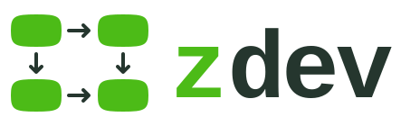

<h1>
  <picture>
    <source media="(prefers-color-scheme: dark)" srcset="assets/zdev-logo-light.svg">
    
  </picture>
</h1>

Zdev coordinates repository work with coding guidance, durable tasks, and
independent review and verification. A coding harness explores the code and
implements a task. A separate agent reviews the implementation and verifies it
against the task requirements and the repository's standards.

Coding harnesses can explore a repository, compare designs, implement code,
and review the result. The awkward part is what has to survive between those
activities: the decisions, the task order, the work that has been verified, and
the connection between a task and its Git history.

The `zdev` binary manages a task record in `.zdev`. The zdev skill guides the
harness through planning, implementation, and independent review and verification.
The skill coordinates the work; the binary records its progress.

Zdev is maintained as a personal tool in public. Releases target macOS and
Linux on x86-64 and Arm64.

> [!WARNING]
> The whole zdev project is vibe-coded: I have spent little time reviewing the
> code myself. I use it a lot, and it has been useful for my work.

Documentation: [zayenz.se/zdev](https://zayenz.se/zdev/).

## Install

For an existing installation, follow [Upgrade to 2.1](docs/upgrading-to-2.1.md);
from 1.x, start with [Upgrade to 2.0](docs/upgrading-to-2.0.md).

Versioned binaries are available from the
[latest GitHub release](https://github.com/zayenz/zdev/releases/latest). For
installation from source with a Rust toolchain, use Cargo:

```sh
cargo install zdev --version 2.1.0 --locked
```

From a local checkout, use `cargo install --path . --locked`.

## The binary: a task record

The binary is the repository-backed task system. It keeps areas, briefs,
individual task files, dependencies, status, branch metadata, and stable
identifiers for accepted Git changes. An area groups one objective and the
tasks that implement it.

### Initialize a repository

On the project's trunk branch, choose how the `.zdev` record should be kept:

- `personal` keeps it in this clone. Add `/.zdev/` to `.git/info/exclude`.
- `project` keeps it as durable, collaborative repository state.
- `pull-request` keeps it on the feature branch during review and removes it
  before squash merge.

Initialize zdev, then create an area on a feature branch:

```sh
zdev init --record personal # or: project, pull-request
git switch -c scheduling
zdev area create scheduling \
  --title "Scheduling support" \
  --objective "Add a tested scheduling API."
```

Zdev creates `area.toml`, `brief.md`, `TASKS.md`, and a `tasks/` directory under
`.zdev/scheduling/`. The individual task files are authoritative; `TASKS.md` is
generated from them.

Keep unfinished plans, future ideas, and collected research under
`.zdev/_notes/`, as individual files or folders of related documents. The skill
supports **add note**, **list notes**, and **make area from note**. Notes have no
required format and stay outside the task queue. See
[Notes for future work](docs/user-guide.md#keep-notes-for-future-work).

### Add and select tasks

The skill normally produces a task bundle for the binary to import. Other tools
can produce the same JSON format:

```sh
zdev tasks import scheduling --from path/to/tasks.json
```

The harness normally stores a proposed bundle for review, has an independent
reviewer check non-trivial work, and shows you the final Markdown. Once you
approve it, the harness imports that exact version. It carries the review ID
for you. For tracked records, the import can commit the tasks and an approved
brief update together.

You can delegate task creation and import with “create and import the tasks
without asking me.” The harness reviews and validates the bundle, then imports
it within that authority. AFK tasks may split into useful in-scope tasks without
another approval; scope and acceptance criteria still apply.

See [Import reviewed tasks](docs/user-guide.md#6-import-reviewed-tasks) for the
review commands and approval rules. Direct `--from` import remains available
for manual use.

Check the area and select its next ready task:

```sh
zdev status scheduling --format json
zdev next scheduling --format json
```

Harness workflows use `zdev work-context` to collect the selected task, branch
status, and Git changes together. They can store this context for worker
handoffs and compare it with fresh state before completion. See
[Work-context snapshots](docs/workflow-round-trips.md) for the snapshot commands.

With only an area, zdev selects ready work by AFK suitability, priority, then
numeric task ID. If you give the loop a focus, the harness reads all ready
tasks and chooses the best fit.

Activate the installed zdev skill and ask it to loop or set a goal for an area.
Both words select the same route. The skill continues one verified commit at a
time where the harness supports native continuation; OpenCode and Pi stop after
one task and report `CONTINUE` when fresh ready work remains.

### Run serial research in Codex and Claude Code

Configure an open research area with a measured baseline and executable
correctness/evaluator commands, then ask `$zdev` to **run research in the area**
within a stated scope. Codex and Claude Code use separate serial routes that generate
supporting tasks and hypotheses, execute them on the current branch, and read
retained lessons before proposing more work. The default allowance is 20 work
attempts; explicitly asking to run **until interrupted** removes that default
while retaining supplied targets, time and command limits.

The coordinator independently verifies candidates proposed for keep and checks
rejected results itself. Local experiment finalize retains candidate history,
keeps or restores code, and commits the task's measured conclusion. Empty queues
permit more scoped proposals; target, budget, interruption and shared blocker
are distinct stops. A fresh session resumes the same run and its remaining
allowance from durable records. Ordinary Implement and Loop keep their existing
behavior. See [Serial research](docs/research.md#serial-research-in-codex-and-claude-code) for
requests, accounting and recovery.

Codex and Claude Code also support an explicit **rolling research** request with separate
worker and measurement limits. It refills free role capacity while siblings
prepare, starts each source from current accepted code, and serializes destination
acceptance. Stale candidates reconcile and remeasure. See
[Rolling research](docs/research.md#rolling-research-in-codex-and-claude-code).

### Complete and commit work

After the harness has implemented and reviewed the task, record the result and
commit the staged changes:

```sh
zdev task done scheduling scheduling-001 \
  --summary "Implemented and independently verified the scheduling model." \
  --validation "Focused model tests passed."
git add <explicit-implementation-path>... \
  .zdev/scheduling/tasks/001-add-the-scheduling-model.md \
  .zdev/scheduling/TASKS.md
zdev commit -m "feat: add scheduling model"
```

`zdev task done` records the supplied result and validation summary. It does
not implement or review the code. `zdev commit` commits the existing Git index
and adds a stable `Zdev-Change-Id` trailer.

A managed task-import commit, including a modified area brief when present,
does not interrupt the selected task. Zdev considers the additions the next
time you run `zdev next`.

For a `pull-request` record, commit `.zdev` normally during review. Immediately
before squash merge, use a clean feature branch and run:

```sh
zdev cleanup squash
```

This creates one plain Git commit deleting only tracked `.zdev` files. It has
no `Zdev-Change-Id`; checked-in harness integrations outside `.zdev` remain.
The command prepares the final tree only. A normal merge or rebase that retains
feature commits still keeps `.zdev` in reachable history.

## The skill: a harness workflow

The skill supplies contextual coding advice throughout planning, implementation
and review. Shared guidance covers design, naming, contracts, control flow and
completion. Language and framework supplements are loaded for the affected code;
project instructions and explicit user requirements determine how they apply.

Independent review checks readability as well as behavior. Required corrections
need checked locations and concrete consequences; optional suggestions do not
block acceptance. Implementers check names and responsibility boundaries before
claiming readiness; reviewers assess them explicitly before a pass. Passing
tests does not waive these requirements. Ordinary implementation allows one
correction pass followed by a focused recheck. If required corrections remain,
the harness preserves the work and reports the decision needed to continue.
The guidance also watches for death loops: repeated failed fixes, unchanged
retries, or task splitting without implementation progress. A retry needs a
concrete changed approach; repeated failure preserves the work and reports
what is needed to continue.

Ask the harness for `zdev review` to review local changes, or supply a branch,
commit range, files, or code boundary. This read-only skill route works without
`.zdev` and reports checked findings, including naming and decomposition issues.
Use **Verify** to assess an explicit ready task for acceptance. `zdev review` is
a harness request, not a binary subcommand.

The skill is the normal way to use zdev from a coding harness. It is installed
by the same binary and uses the same `.zdev` task record.

Check or install a user-scoped skill for the harness you use:

```sh
zdev skill check codex --scope user
zdev skill install codex
# or: claude, opencode, pi, omp, agy
```

User-scoped skills work across repositories. To install one in the current
repository, initialize zdev first and use project scope:

```sh
zdev skill install codex --scope project --guidance auto
```

Project installations put harness-native files under `.codex`, `.claude`,
`.opencode`, `.pi`, `.omp`, or `.agents`. The supported harnesses are Codex,
Claude Code, OpenCode, Pi, Oh My Pi, and Google Antigravity (`agy`).

Once installed, ask the harness to use zdev explicitly. The usual workflow is:

1. **Explore an objective** to build or revise the area's brief.
2. **Discuss the brief** to test choices that could change scope, behavior,
   task boundaries, or validation.
3. **Create tasks** to turn the agreed brief into task files for the binary to
   import.
4. **Implement** the next ready task within the brief and task boundaries.
5. **Review and verify** the task and diff with a separate agent in a fresh
   context, checking both the task requirements and repository standards.
6. Complete the task and commit the accepted changes through the binary.

**Improve** surveys the codebase and proposes candidate work without creating
tasks or changing production code. **Investigate** answers one named
uncertainty through research, diagnosis, or a disposable prototype. Both can
remain read-only until their result becomes part of an agreed objective.

The skill does not replace the task record or make design decisions on behalf
of the developer. It gives the harness a common route through the brief, task
selection, implementation, review, verification, and completion steps that the
binary records.

Use `zdev config` to inspect project settings and choose worker models:

```sh
zdev config show
zdev config get project.trunk
zdev config set worker.codex.implementer gpt-6.1-sol high
zdev config unset worker.codex.implementer
```

Tasks may declare complexity as `routine`, `standard`, or `advanced`; omission
means `standard`. Routine work uses the routine implementer. Advanced work gets
a read-only plan before its first edit. Every route uses a fresh standard
verifier.

Inside T3 Code, Codex and Claude Code coordinate workers through T3's MCP by
default. Name the route to choose worker harnesses: “Use zdev with T3
orchestration to loop through area scheduling, using Codex for implementation
and Claude Code for verification.” Ask for native orchestration to opt out.
This uses the same task records and verification gates, with sequential T3-owned
workers. Goal/loop uses the main thread's visible T3 `/goal` and reports each
phase there, while completion wakes deliver worker results; it does not use
Claude's packaged workflow.
See [T3 Code coordination](docs/t3-code.md) for installation and limits.

## Area reports

The companion [zdev-area-report skill](skills/zdev-area-report/SKILL.md)
researches an area and writes a report for readers who have not followed its
development. It includes question prompts, MDX fixtures and an Astro renderer.
Editable source and a self-contained HTML reading copy live together under
`.zdev/reports/<area>/<date>-<name>/`. Reports normally use prose and tables;
small JavaScript widgets are available when interaction helps explain a result.

The skill is available from this checkout and the Codex plugin's skills
directory. It is separate from the binary's existing `zdev skill install`
workflow. Its [generation guide](skills/zdev-area-report/references/generation.md)
describes dependency setup and the `init` and `build` commands.

## Adapted skills

The zdev skill adapts methods from three upstream skill projects:

- [Matt Pocock's skills](https://github.com/mattpocock/skills/tree/d574778f94cf620fcc8ce741584093bc650a61d3)
  cover discussion, exploration, task decomposition, implementation, research,
  diagnosis, review, and codebase design. His
  [`writing-for-agents`](https://github.com/mattpocock/skills/blob/3cca18b368ae95cdbdebbff572ccafa662551015/skills/productivity/writing-for-agents/SKILL.md)
  guidance also shapes how zdev writes briefs, tasks, context pointers, and
  worker instructions. The source is released under the
  [MIT license](https://github.com/mattpocock/skills/blob/d574778f94cf620fcc8ce741584093bc650a61d3/LICENSE),
  © Matt Pocock.
- [Cursor pstack's `unslop` skill](https://github.com/cursor/plugins/blob/93b00b89ef425a9c1bac0d0b317dfc49c930ac99/pstack/skills/unslop/SKILL.md)
  by Lauren Tan is built into zdev's shared guidance for human-facing prose. It
  favors concrete facts, plain active language, stable terms, and a final pass
  for generic or formulaic writing. The source is released under the
  [MIT license](https://github.com/cursor/plugins/blob/93b00b89ef425a9c1bac0d0b317dfc49c930ac99/pstack/LICENSE),
  © Lauren Tan.
- [shadcn's Improve skill](https://github.com/shadcn/improve/tree/03369ee6d7cafbfcecc4346539b05b3dc0a603bb)
  informs the read-only codebase survey, audit, vetting, and prioritization
  steps. Its [license statement](https://github.com/shadcn/improve/blob/03369ee6d7cafbfcecc4346539b05b3dc0a603bb/README.md#license)
  identifies it as MIT © shadcn.

The adaptations are self-contained references under `skills/zdev/`; zdev does
not load the upstream skills at runtime. See the [adapted
methods](docs/adapted-methods.md) for the source mapping and pinned revisions.
Zdev's own code and documentation are covered by the [MIT license](LICENSE).

## Learn more

- [User guide](docs/user-guide.md): the complete installation and first-run path
- [Workflow reference](docs/workflow.md): branch, verification, rebase, and
  recovery semantics
- [Task format](docs/task-format.md): the task-file contract
- [Changelog](CHANGELOG.md): notable changes in each release
- [Contributing](CONTRIBUTING.md): local checks and generated-file guidance
- [MIT license](LICENSE)

Run `zdev --help` or `zdev <command> --help` for command details.

## Development

```sh
cargo fmt --all -- --check
cargo clippy --locked --all-targets --all-features -- -D warnings
cargo test --locked
cargo build --locked
git diff --check
```
