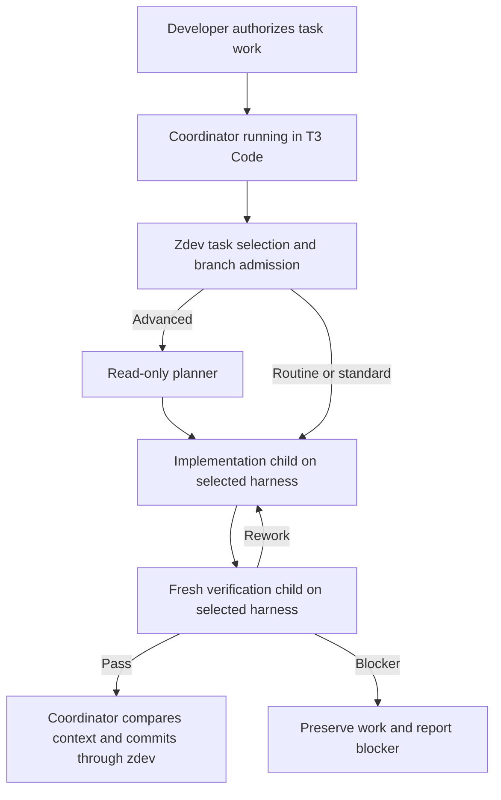

# T3 Code orchestration for zdev

Use T3 Code as the session and execution layer, while zdev keeps the development
workflow and repository task record. A coordinator running in T3 Code can select
an approved zdev task, dispatch its workers to different harnesses, inspect their
results, and complete one verified commit. Changing the coordinator's harness
should leave that process intact.

Start with a sequential integration for Codex and Claude Code, piloted on zdev
itself. Package it for other repositories after the pilot works. This plan assumes
the intended outcome is reusable zdev support; a workflow solely for developing
zdev can stop after the pilot.

## Implementation status

The coordinator route is now packaged in both root skills. Inside T3 Code it
is the default route; outside T3 Code the native routes are unchanged. An
explicit request **with T3 orchestration** also selects it, and an explicit
request for native orchestration opts out. It includes mixed-harness profile
resolution and goal/loop continuation through one visible T3 parent goal.
Native goal turns and child wakes reconcile the same coordinator state. No
installer flag, scheduler, or additional stored state was needed. See
[usage and current limits](t3-code.md).

Packaging preceded the live pilot so the same instructions can be tested from
either coordinator. Source-contract and repository checks do not establish live
provider qualification; the handoff and recovery scenarios below remain to run
with authenticated T3 providers.

## Research findings

Research date: 2026-10-08. The source examined is T3 Code nightly
`v0.0.46-nightly.20261008.2801`, commit
[`d720210996a514368ba99f4860063110033d93fa`](https://github.com/pingdotgg/t3code/tree/d720210996a514368ba99f4860063110033d93fa).
These findings come from release notes and source inspection. They establish API
behavior, but live zdev execution through T3 Code still needs qualification.

V2 first shipped on October 3. It adds cross-provider delegation, thread controls,
visible child execution, server queues, restart handling, and scheduling. T3
recommends delegation for combining harnesses: switching provider inside a thread
transfers a limited selection of messages and loses other working context.
[V2 release announcement](https://github.com/pingdotgg/t3code/releases/tag/v0.0.46-nightly.20261003.2610).

The useful change for zdev is app-owned orchestration across harnesses. A parent
still runs in a particular harness and decides what to do. T3 supplies the shared
execution machinery; it does not supply zdev's development policy. Its MCP tools
are distinct from each harness's native subagent tools.
[MCP architecture](https://github.com/pingdotgg/t3code/blob/d720210996a514368ba99f4860063110033d93fa/docs/orchestration-v2/orchestrator-mcp-server.md).

| Capability checked | Consequence for zdev |
| --- | --- |
| `orchestrator_capabilities` reports provider instances, models, model options, and availability | Resolve actual targets from the running server rather than inventing provider IDs or maintaining a model catalog. |
| `delegate_task` accepts a target instance, model, and options | Planner, implementer, and verifier can use different harnesses. |
| A delegated child receives the supplied prompt without parent conversation history | Give it repository and task locators; create a fresh verifier for every verdict. |
| `task_status` returns the final result and distinguishes active work from an available result | T3 completion is execution status; zdev must separately validate the worker verdict. |
| Async completion wakes the parent; a wait timeout leaves the child running | Retain the task handle and await delivery or read its status. A timeout must not cause duplicate implementation. |
| Delegation accepts a retry key | Reuse a key for retrying one dispatch, and use a new key for a genuinely new worker round. |

These are current contracts in the
[MCP schema](https://github.com/pingdotgg/t3code/blob/d720210996a514368ba99f4860063110033d93fa/packages/contracts/src/orchestratorMcp.ts)
and [service implementation](https://github.com/pingdotgg/t3code/blob/d720210996a514368ba99f4860063110033d93fa/apps/server/src/mcp/OrchestratorMcpService.ts).
The architecture document's delegation example omits `target.options`; the actual
schema includes it. Explicit unsupported model options are rejected.

Four boundaries need particular attention:

1. **Workspace:** delegated children inherit the parent's project, branch, and
   worktree. `delegate_task` has no workspace override. A prompt telling a child
   to change directory does not change T3's workspace binding.
   [Child projection](https://github.com/pingdotgg/t3code/blob/d720210996a514368ba99f4860063110033d93fa/apps/server/src/orchestration-v2/SubagentProjection.ts),
   [injected orchestration instructions](https://github.com/pingdotgg/t3code/blob/d720210996a514368ba99f4860063110033d93fa/apps/server/src/provider/T3OrchestrationInstructions.ts).
2. **Roles:** T3's `implementation`, `review`, and `design` values add a short
   prompt prefix. They do not select a zdev agent definition or enforce its tool
   restrictions. Supply the actual zdev role contract explicitly. Child modes
   cannot grant broader permissions than the parent.
   [Role handling and mode policy](https://github.com/pingdotgg/t3code/blob/d720210996a514368ba99f4860063110033d93fa/apps/server/src/mcp/OrchestratorMcpService.ts).
3. **Rework:** another delegated review round requires a new delegation with the
   complete relevant context. Thread messaging does not reopen a completed
   delegated task. Initially use a fresh implementation child for repairs too,
   supplying the baseline and findings. This avoids depending on session reuse.
   [Tool guidance](https://github.com/pingdotgg/t3code/blob/d720210996a514368ba99f4860063110033d93fa/apps/server/src/mcp/toolkits/orchestrator/tools.ts).
4. **Harness coverage:** Codex, Claude, OpenCode, Pi, Cursor, Grok, and ACP have
   built-in adapter entries in the inspected nightly. Antigravity uses ACP.
   Oh My Pi has no dedicated adapter entry; compatibility needs its own proof.
   [Adapter registry](https://github.com/pingdotgg/t3code/blob/d720210996a514368ba99f4860063110033d93fa/apps/server/src/orchestration-v2/builtInProviderAdapterDrivers.ts),
   [ACP guide](https://github.com/pingdotgg/t3code/blob/d720210996a514368ba99f4860063110033d93fa/docs/user/providers-acp.md).

Nightly behavior is still changing. An early Claude completion-notification bug
cancelled pending tools; the fix merged on October 5 queues automatic notices
behind active work. Qualify the selected build, including this interaction,
instead of treating the first V2 release as the compatibility baseline.
[Merged fix](https://github.com/pingdotgg/t3code/pull/15892).

## Responsibility split

| Layer | Owns |
| --- | --- |
| Developer | Objectives, approval of task bundles, product choices, and authorization to continue work. |
| Zdev coordinator instructions | Task selection, worker routing, result validation, rework, verification gates, completion, and commits. |
| Zdev CLI and `.zdev` | Briefs, task graph, task status, branch checks, work-context snapshots, and accepted Git changes. |
| T3 Code | Threads, provider sessions, dispatch, results, cancellation, queues, wakeups, and execution presentation. |
| Worker harness | File and command tools, native configuration, authentication, permissions, and its own session mechanics. |

The coordinator is an agent using zdev inside T3 Code. It can run in either
qualified harness. T3 is an orchestration choice alongside those harnesses;
adding it as a seventh `WorkerHarness` would mix two separate choices.

This follows zdev's existing ownership contract: workers implement or verify;
coordination owns lifecycle and commits. Runtime handles already belong to the
harness rather than `.zdev`.
[Current orchestration contract](harness-orchestration.md).

Default to one ordinary coordinator thread per active area and authoritative
checkout. Several areas may share a thread and checkout. Pin the thread while
active and include the selected area in its title. Delegated threads represent
worker attempts, so a single zdev task can have several T3 children. T3's message
queue carries follow-up instructions; task dependencies and readiness continue to
come from zdev. Settling a thread does not close an area or complete a task.

For developing zdev itself, open the chosen checkout in T3, select the intended
area, and keep all task records and final commits there. Separate areas may have
separate coordinator threads and checkouts when their recorded branch rules
require it. A discussion thread can help shape work, but implementation starts
from the approved brief and tasks.

## One task through T3 Code

The sequential route uses one checkout and one source writer at a time:

1. The coordinator stores `zdev work-context <area> --store --format json`,
   checks task identity and branch safety, and retains the baseline.
2. It resolves and freezes role settings for the run. Advanced work receives a
   read-only planner before implementation, following existing complexity rules.
3. It delegates implementation with the absolute checkout, brief and task paths,
   baseline snapshot, role contract, and expected result envelope. The child
   performs source work and validation. It leaves `.zdev`, staging, and commits
   to the coordinator and starts no nested workflow.
4. After accepting the implementation result, the coordinator stores fresh
   verification context and delegates a new verifier. That worker inspects the
   task and whole diff, runs the required checks, and returns the existing four
   semantic fields.
5. The coordinator compares the snapshot and routes `rework`, `blocker`, or
   `pass`. Repairs get the full findings; each repair gets a new verifier.
6. A valid, unchanged verification pass permits `zdev task done`, explicit
   staging, staged-diff inspection, and `zdev commit`. A T3 task marked completed
   alone permits none of these actions.
7. Ordinary implementation stops after the commit. An explicitly authorized loop
   collects fresh context and selects the next task.

Prefer async dispatch for long worker steps. The parent ends its turn while the
child works, then handles T3's completion wake. It checks the task handle before
any replacement dispatch. Short dependent steps may use a bounded wait; expiry
means the result is still pending. Workers must return the documented envelope
as their final answer so the coordinator can validate it.

The coordinator's dispatch instruction must explicitly request T3-owned children,
including same-harness workers. T3's default guidance otherwise prefers native
subagents when they can supply the chosen model.
[T3 orchestration instructions](https://github.com/pingdotgg/t3code/blob/d720210996a514368ba99f4860063110033d93fa/apps/server/src/provider/T3OrchestrationInstructions.ts).

## Goal and loop continuation

Goal and loop remain aliases for the same zdev operation: complete approved work
in one named area, one independently verified task and commit at a time. Inside
T3 Code the root skill selects the T3 route by default and loads it before
choosing a native Codex goal or Claude workflow. An explicit request such as
"Use zdev with T3 orchestration to loop through area X." also selects it, and
an explicit request for native orchestration opts out.

Start the loop with T3's visible `/goal`, carrying the zdev stop condition and
worker choices; [the usage guide](t3-code.md) supplies the exact command. Exposed
native tools may establish it after inspecting clear goal state. Without an
activation surface, the skill prepares the command before dispatch. T3 exposes
this UI for both Codex and Claude, while the provider owns continuation.
[Goal UI implementation](https://github.com/pingdotgg/t3code/pull/15592),
[goal state contract](https://github.com/pingdotgg/t3code/blob/d720210996a514368ba99f4860063110033d93fa/packages/contracts/src/orchestrationV2.ts).

Native goal turns and child-completion events resume the same coordinator:

1. Select a task from fresh work-context and dispatch its first worker, then
   yield while that worker runs.
2. Any continuation reconciles the retained task handle before dispatch. An
   active child remains pending. A completion reads the exact result through
   `task_status`, validates it, and dispatches the next phase: planning,
   implementation, verification, or repair as appropriate.
3. After a valid verifier pass, compare context and complete and commit the task.
4. In that same coordinator turn, collect fresh context. If another task is ready
   and safe, dispatch its first worker before yielding again. Otherwise report
   the existing zdev loop stop result.

The coordinator retains the area, optional focus, frozen role settings, current
task and snapshot, worker handles, and completed task/commit pairs in its
conversation. Task records and commits remain the durable progress checkpoints.
Do not introduce a separate loop record or scheduling service.

| Route | What drives continuation |
| --- | --- |
| Current Codex | The native goal runtime keeps invoking the coordinator against an area-sized stop condition; native workers handle task phases. |
| Current Claude Code | The packaged JavaScript workflow repeats the one-task body and retains workflow variables; its `agent()` calls dispatch native workers. |
| T3 Code | One visible native parent goal continues the main coordinator; T3 owns child execution and completion delivery. Both entry paths use the same pending handles and phases. Workers can use different harnesses. |

The T3 route uses the parent native goal displayed by T3 and never starts a
separate Claude JavaScript loop, second goal, or timer. T3 mirrors goal state;
the main provider still executes continuation and evaluation. A fully
provider-independent loop runtime would require an upstream T3 feature.
Qualification must exercise task boundaries and overlapping goal turns and
child wakes without duplicate workers. Goal completion is run termination,
including the explicit blocker stop condition, not a zdev verification pass.

Stop on a genuine blocker, unsafe state, required user decision, explicit stop,
or fresh empty, exhausted, or closed context. Empty or exhausted work does not
close the area. Rework stays within the current task and gets another fresh
verifier. A stopped run must account for active workers and preserve unfinished
changes before any later replacement dispatch. Codex Stop pauses its goal;
Claude Stop retains it and may evaluate it after the next message. A stopped
zdev run therefore needs explicit resume regardless of a later native check.

Restart behavior uses T3's configured execution recovery and zdev's existing
recovery checks. Inspect the existing child and fresh Git/task state before
resuming. A commit already recorded is progress; a partial diff needs recovery.
Neither a restored T3 session nor a repeated completion notification substitutes
for a new verification/completion check. If the coordinator's control context is
insufficient, report the preserved state and require explicit resume.

## Profiles across harnesses

The current resolver selects a model and effort for one harness and role.
`dispatch-spec` similarly resolves every role under one harness. Neither selects
a different harness for each role.
[Worker profile contract](worker-profiles.md), [profile resolver](../src/config.rs),
and `dispatch_spec` in the [CLI implementation](../src/lib.rs).

For the pilot, specify a small role-to-provider table in the coordinator
instructions. For example, planner and verifier can use Claude Code while the
implementer uses Codex. This is a routing example, not a model-quality ranking.
Then:

- Resolve each role through `zdev config profile resolve <worker-harness> <role>
  --area <area> --format json`, with existing run and role overrides when chosen.
- Freeze the returned settings and the selected T3 instance for the whole run.
- Match models and effort values to T3's live advertised IDs and option
  descriptors. Claude aliases and different harness naming conventions require
  an explicit verified match.
- Send the concrete instance, model, and options through `delegate_task`.
  Report unsupported settings instead of silently selecting another model.

Do not reuse a single-harness dispatch specification as though it were a mixed
one. The pilot can follow existing route instructions and call the role resolver
separately. Add a persisted routing table only after repeated use demonstrates
that maintaining it in the prompt is inconvenient. Keep model and effort
preferences in the existing profile system.

## Implementation sequence

### 1. Prove the handoff with existing commands

Use a pinned V2 nightly, installed and authenticated Codex and Claude providers,
and an ordinary T3 thread bound to the correct zdev checkout. The migration guide
lists minimum versions of Codex 0.159 and Claude Code 2.1.280, but qualification
must record the exact versions actually used. Existing V1 conversation migration
copies data into V2; the copies do not subsequently synchronize.
[Migration guide](https://github.com/pingdotgg/t3code/issues/14871).

First perform a harmless read-only delegation to prove checkout access, profile
translation, and exact JSON result delivery. Then use one separately authorized
small task to exercise implementation, a fresh verifier, and a coordinator-owned
commit. Supply coordinator instructions directly; reuse installed zdev CLI and
contracts. This stage needs no Rust change or new scheduler.

Exit: the task has one correct zdev commit, workers have respected their roles,
and the coordinator has received and validated the expected envelopes.

### 2. Package the coordinator route

Add a short T3 dispatch reference under `templates/zdev/`, rendered through the
existing integration installer. It replaces worker dispatch for the selected
T3 route while retaining the shared task and verification contracts.
Keep reusable worker role text accessible by file locator.

The interface first shipped as an explicit request **with T3 orchestration**
through the root skill. That explicit-only selection is superseded: the T3
route is now the default inside T3 Code, and an explicit request for native
orchestration opts out. See [Coordinate zdev in T3 Code](t3-code.md) for the
current behavior. Both installers package the reference; no installation
option is needed. The coordinator selects the dispatch contract for that run,
while its worker models still belong to their actual harnesses.

Likely seams: `src/integrations.rs`, canonical root and task templates, and
`docs/harness-orchestration.md`. Regenerate fixtures through the existing process.
Qualify the route with both Codex and Claude as coordinator to demonstrate that
coordination is not tied to one harness.

Exit: both coordinators can use the same T3 route, and ordinary native zdev
installations retain their current behavior.

### 3. Qualify rework and recovery

Use a disposable repository for a few manual scenarios:

| Scenario | Required behavior |
| --- | --- |
| Verifier requests a repair | New implementation attempt receives complete findings; a fresh verifier checks the whole repaired task. |
| Context changes during verification | Snapshot comparison prevents completion on the obsolete verdict. |
| Wait expires or a response is lost | Existing execution is inspected; implementation is not dispatched twice. |
| Worker is stopped or server restarts | Coordinator rechecks live execution and Git state before resuming; uncertain work remains preserved. |
| Result is malformed or model options are unsupported | Coordinator reports a concrete blocker and does not complete the task. |
| Completion succeeded but final commit failed | Recovery finishes the existing completion checkpoint rather than reimplementing the task. |

Run the repository's normal required checks for any implementation changes.
Automate focused checks only for new parsing, configuration, or rendering behavior
owned by zdev. Keep T3 runtime qualification as a short reproducible checklist;
do not recreate its provider test infrastructure.

Restart delivery restores execution context, not a verified development outcome.
Resume uses T3's existing child status plus zdev's recovery contract. Keep handles
and frozen role settings in the coordinator's conversation initially; if a handle
is missing, inspect its children before starting new work.
[Work-context checks](workflow-round-trips.md), [recovery contract](../skills/zdev/references/recovery.md).

Exit: these cases preserve task identity, ownership, verification, and one final
commit without a second durable run record.

### 4. Add routine organization and continuation

Use readable titles containing area, task ID, role, and attempt; link the area's
PR from its coordinator thread where useful. Run an authorized area loop through
fresh task selection after each commit. Keep one active coordinator for each
authoritative checkout and avoid concurrent writers from unrelated threads.

Add Pi or OpenCode only when needed and qualify their installed zdev contract
discovery and model settings. Evaluate scheduling later for a concrete request,
such as a recurring read-only status check. Scheduled wakeups must follow existing
authorization and reconcile active work before dispatch.

Exit: normal development can move between qualified coordinator harnesses while
the durable brief, tasks, and accepted commits remain usable independently of T3.

### 5. Consider parallel work after isolation is solved

The present delegation API makes sequential work straightforward. It does not
provide isolated delegated source worktrees. Do not run multiple implementation
children in the inherited checkout.

If parallel work becomes valuable, evaluate two concrete paths: upstream support
for a workspace binding on delegated tasks, or explicitly requested ordinary T3
threads bound to assigned source worktrees through `t3_thread_launch`. The latter
changes the interaction into separately managed conversations and must be treated
as such. It must retain zdev's serial destination integration, fresh verification,
completion, and commits. T3 context merge-back is separate from this Git process.
[Launch instructions](https://github.com/pingdotgg/t3code/blob/d720210996a514368ba99f4860063110033d93fa/apps/server/src/provider/T3OrchestrationInstructions.ts),
[zdev parallel contract](../skills/zdev/references/parallel.md).

Exit: a finite two-task batch has isolated writers and serial accepted commits.
Until then, parallel implementation remains unsupported by this route.

## First milestone

One approved task completed through a T3 coordinator, an implementation worker on
one harness, and a fresh verifier on another, using existing zdev state and one
coordinator-owned commit. Then repeat with the other coordinator harness.

That is enough to establish the organizational separation. Packaging, persisted
routing preferences, additional harnesses, scheduling, and parallel execution can
follow demonstrated needs.
